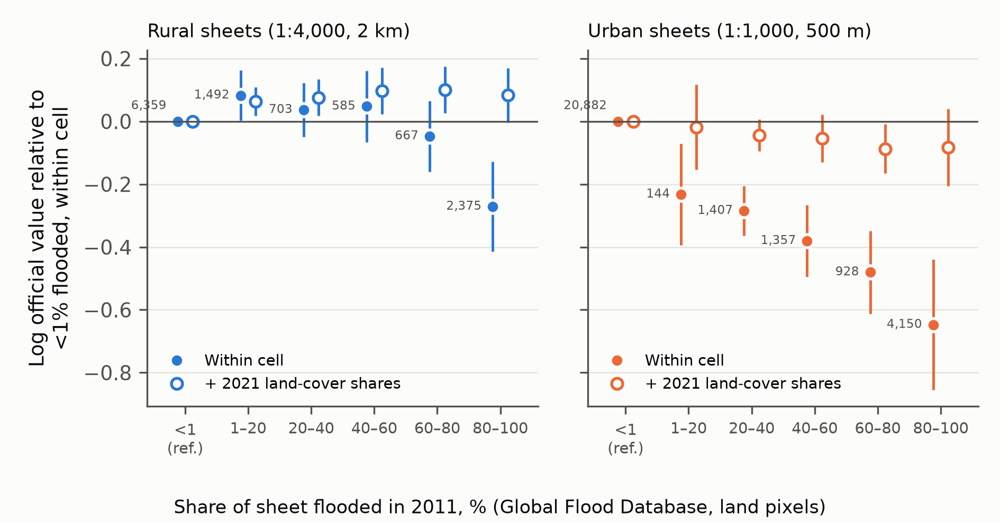
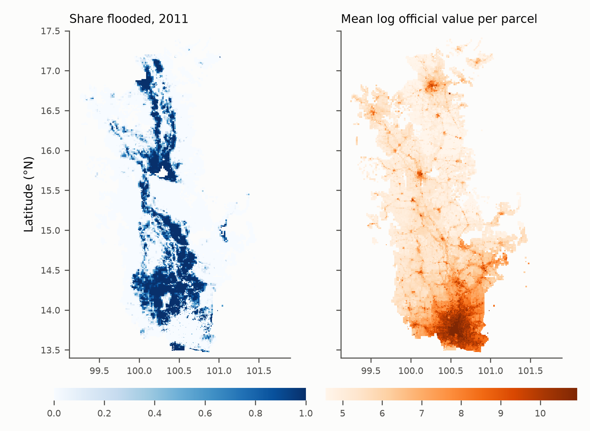
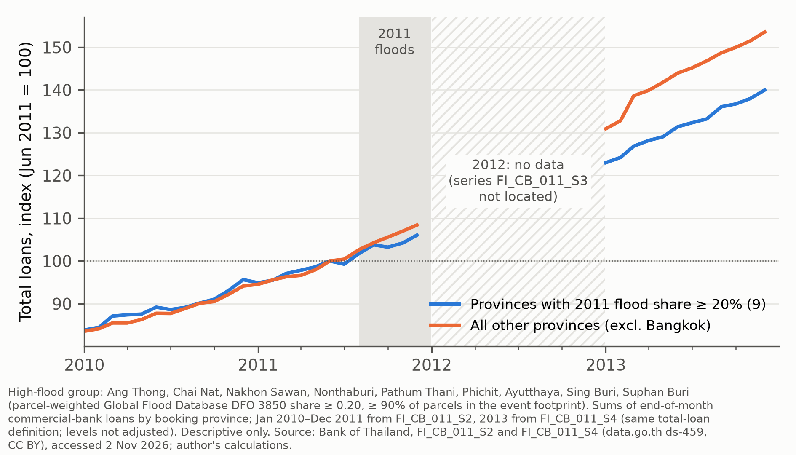

# Pilot report: public-data groundwork for "Underwater Collateral"

**Working draft, 2026-11-02 (Phase 5).** This is the author's working document. The user will rewrite it in their own voice.

**Scope.** Everything here is descriptive. Every number is the output of a script in `04_analysis/src/`, rebuilt by `.venv/bin/python -I 04_analysis/run_all.py` and stored under `04_analysis/outputs/`. Only public data were used.

**Sources for policy statements.** Every statement about Bank of Thailand (BOT) policy cites a public document.

**How to read the labels.** Three kinds of statement are kept apart:
- **Fact**: a script output or a cited source.
- **Hypothesis**: one of the user's research hypotheses, from `05_design/research_questions.md`.
- **Speculation**: my own reading, labelled as such.

## 1. What the pilot set out to show

The pilot asks three questions before the proposal commits to its design:

1. Can the public Treasury appraisal schedule be placed on a map finely enough to be linked to satellite flood exposure?
2. Is there a raw gradient between official land values and 2011 flood exposure worth explaining?
3. Do the planned designs have enough treated units, and is the restricted-data pipeline ready to run the day access is granted?

The answer to all three is a qualified yes. The qualifications matter as much as the answers, and Section 9 lists them.

## 2. Data assembled

| Dataset | Coverage used | Licence | Script |
|---|---|---|---|
| Treasury Department land appraisal values (ราคาประเมินที่ดิน), 2023–26 round, parcel level | 77 province files; 37,806,594 parcels with a positive value | DGA Open Government Licence | `download_treasury_appraisal.py` |
| Global Flood Database (GFD), event DFO 3850 (2011), about 250 m [@tellman2021satellite] | Event footprint (see Section 9) | CC BY-NC 4.0 | logged in `03_data/README.md` |
| JRC Global Surface Water v1.4, occurrence, 30 m [@pekel2016high] | 97–106°E, 10–20°N | CC BY 4.0 | logged in `03_data/README.md` |
| UNOSAT FL20240912THA water extents, Chiang Rai and Phayao (2024) | UNOSAT analysis extent | CC BY-SA | `exposure_2024_north.py` |
| BOT commercial-bank deposits and loans by province, monthly | see Section 6 | CC Attribution (data.go.th `ds-459`) | `download_bot_provincial_credit.py`, `clean_bot_provincial_credit.py` |

URLs, access dates, file names and SHA-256 manifests are recorded in `03_data/README.md`. Raw files are immutable and stay out of git.

## 3. What Treasury appraisal values are, and what they are not

Full notes with locators are in `04_analysis/treasury_method_notes.md`. The main points:

- **How values are set.** Provincial committees price *land units* (หน่วยที่ดิน) by market comparison, mainly from registered sale prices. A land unit is a road, soi, river, canal or sea frontage. Each parcel's value is then the unit price × a depth factor × a shape factor, rounded to a fixed grid. Sources: Ministerial Regulation B.E. 2563 (2020) [@th2020appraisalmr], ข้อ 1, 4 and 6, and the Treasury Department's guide to using the appraisal schedule.
- **Unit and rounds.** `EVAPRICE` is in baht per square wah (MR ข้อ 7(2)). Rounds last four years (Property Valuation for the Public Interest Act B.E. 2562 (2019), s. 19). The current round started on 1 January 2023. Committees can revise values within a round, and must re-price an area when average sale prices diverge from the schedule by more than 15% (MR ข้อ 9).
- **No flood rule.** The Act, the regulation and the guide contain no rule that adjusts values for flood hazard or low-lying land. Hazard can enter only implicitly, through the market evidence. This conclusion holds only for those three documents: committee-level rules were not found.
- **What the values are for.** They are the base for the 2% transfer fee [@dol2026fees].

**No public BOT rule ties bank collateral values or loan-to-value limits to Treasury values.**
- *Collateral appraisal.* The BOT's 2019 collateral-appraisal policy does not mention them [@bot2019collateral].
- *Loan-to-value limits.* The 2018 Q&A on housing-loan LTV uses the contract sale price or the lender's own appraisal.

**Consequence for the design.** The pilot therefore corrects a premise of the CP2 framing. RQ1 now measures how far the *state's official valuation* capitalises flood hazard; in the framework this is λ_T (`05_design/framework.md` §1). The bank's own collateral appraisal, λ_B, is observable only in Tier 2 data. RQ3 uses λ_T as a proxy for λ_B under a stated assumption, λ_B ≈ λ_T, which is not established: both valuations draw on the same registered-sale evidence. The approved research questions are otherwise unchanged.

## 4. Placing appraisals on the map

**What the public file contains.** The file gives each parcel's Department of Lands cadastral sheet reference (UTMMAP1–4 and the scale), but no coordinates.

**How sheets are located.** `mapsheet.py` decodes each sheet reference into its UTM bounding box on the Indian 1975 datum, then transforms the box to WGS84. 30 unit tests check the decoding.

**Unit of analysis.** The sheet is the unit:
- 2 km squares at 1:4,000, used for rural land;
- 500 m squares at 1:1,000, used for urban land.

**Coverage.** Table 1 gives the coverage. The 4.2% of parcels that cannot be located carry sheet references outside the decoding rules, listed in `outputs/tables/mapsheet_decode_coverage.csv`.

**Table 1. Coverage of the sheet panel (parcel-weighted).**

| Province files | Sheet references | Parcels | Located | With 2011 GFD exposure | With GSW occurrence |
|---|---|---|---|---|---|
| 77 | 317,081 | 37,806,594 | 95.8% | 74.9% | 81.8% |

*Source: `outputs/tables/sheet_panel_coverage.csv`.*

**Prices are coarse within sheets.** The median number of distinct values per sheet is:
- 5 at 1:1,000;
- 11 at 1:4,000.

The source is `outputs/tables/sheet_price_discreteness.csv`. This coarseness is what land-unit pricing implies: a sheet holds a few land units, and parcels within a unit differ only by mechanical depth and shape factors.

**Main outcome.** The main RQ1 outcome is therefore the sheet's 90th percentile of log value. It approximates the price of the best road-front land unit on the sheet. The sheet mean is kept as a secondary outcome, because it mixes in the depth and shape discounts.

## 5. Fact 1: official values are lower on sheets that flooded in 2011

**Sample.** The 17 core provinces of the Chao Phraya basin. Each sheet's 2011 flood share is the share of its land pixels (excluding permanent water) that GFD marks as flooded during event DFO 3850.

**Comparison.** Values are compared *within* cells of province × 1:50,000 map sheet × scale. Each cell is roughly 15 × 15 km.

**Rural sheets.** The binned means in Figure 1 are flat to slightly positive up to 80% flooded. They then fall to −0.37 log points for sheets that were 80–100% flooded.

**Urban sheets.** Values fall steadily from the 20–40% bin onwards, reaching −0.49 log points for the most flooded sheets.

**Slopes.** A weighted within-cell regression gives the slopes in Table 2: about −0.7 to −0.8 log points per unit of flood share for the p90 outcome.



**Figure 1. Log appraisal value (sheet p90) by 2011 flood share, within province × 1:50,000-sheet × scale cells.**
- *Source:* `outputs/figures/fig_appraisal_flood_binned.pdf`; values in `outputs/tables/appraisal_flood_binned.csv`.
- *Markers:* bars are ±2 SE, treating sheets as independent, so they understate the uncertainty.

**Table 2. Within-cell slope of log appraisal value on 2011 flood share (weighted by parcels; SEs clustered by 1:50,000 sheet).**

| Outcome | Sheets | Coefficient | SE | Sheets (n) | Clusters |
|---|---|---|---|---|---|
| p90 of log value | Rural (1:4,000) | −0.733 | 0.148 | 12,181 | 108 |
| p90 of log value | Urban (1:1,000) | −0.815 | 0.111 | 28,868 | 95 |
| Mean of log value | Rural (1:4,000) | −0.488 | 0.106 | 12,181 | 108 |
| Mean of log value | Urban (1:1,000) | −0.650 | 0.098 | 28,868 | 95 |

*Source: `outputs/tables/appraisal_flood_within.csv`.*



**Figure 2. 2011 flood share and log appraisal value (sheet p90) by cadastral sheet, core Chao Phraya basin.**
- *Source:* `outputs/figures/fig_basin_maps.pdf`.

**How to read this.** These correlations are not estimates of λ_T.

**The main confound is land use.** Land that flooded for weeks in 2011 is mostly low-lying paddy far from towns. Its values would be lower even if no committee had ever thought about floods. `05_design/identification.md` sets out the designs meant to separate hazard from land use and location:
- the within-area cross-section with controls for land cover and distance to water;
- the boundary design at the 2011 flood edge;
- the difference-in-differences across rounds.

**Two patterns support that plan.**
- *Rural rise at low flood shares (speculation).* The rural rise at 1–20% flood share (+0.21) is what one would expect if partial flooding marks proximity to rivers and roads, which carry an amenity premium. The land-unit typology prices river and canal frontage separately, so this premium is built into the outcome.
- *Mean versus p90 (fact).* The slope is steeper for the p90 than for the mean, so the gradient is not produced by depth and shape factors.

**What the fact establishes.** The raw gradient exists, is large, and is visible at both scales. A credible design has to explain it, not discover it.

## 6. Fact 2: provincial bank credit around the 2011 floods

**Data.** BOT publishes commercial-bank loans and deposits by booking province each month. The pilot uses two series:
- FI_CB_011_S2, July 2005 to December 2011;
- FI_CB_011_S4, January 2013 to June 2025 (S4 was frozen at its August 2025 update);
- FI_CB_011_S5, its successor, July 2024 to July 2026 (S5 kept for the overlap).

**The 2012 gap.** The 2012 series (FI_CB_011_S3) could not be located on the BOT site, so 2012 is missing and is not interpolated.

**Bangkok.** Bangkok head-office balances are booked centrally, not locally, so Bangkok is left out of the comparison.

**Groups.** Provinces are grouped by a rule fixed before the credit data were examined:
- **High-flood group:** a parcel-weighted 2011 GFD flood share of at least 20%, among provinces with at least 90% of parcels inside the GFD footprint. Nine provinces qualify, all in the Chao Phraya basin.
- **Comparison group:** every other province.



**Figure 3. Commercial-bank loans by booking province, index (June 2011 = 100).**
- *Source:* `outputs/figures/fig_provincial_credit_2011.pdf`; values in `outputs/tables/fig_provincial_credit_2011_data.csv`.

**What the series show.**
- **Before the floods.** The two groups grow in step from January 2010 to mid-2011.
- **During the floods.** They separate from October 2011. By December 2011 the high-flood group stands at 106.0, against 108.4 for the rest.
- **After the gap.** When the series resumes in January 2013 the gap is 123.0 against 130.9. By December 2013 it has widened to 140.0 against 153.5.

**Limits on reading the series.**
- **No timing.** The missing year hides when the gap opened.
- **Series break.** The S4 series adds an "other loans" component inside the same total, and the levels are not adjusted across the break.
- **Step in the comparison group.** The comparison group jumps by about six index points between February and March 2013. This may be a reporting change and has not been explained.

**Interpretation (speculation).** Slower credit growth in flooded provinces fits any of three readings: weaker demand from damaged firms, tighter supply, or relief that froze balances. Aggregate booking data cannot tell them apart.

**Role in the proposal.** This is why RQ2 needs loan-level data. The figure motivates RQ2; it does not answer it. If the provincial series is used further, a Plan B for RQ2 would pair it with the 1996–2005 series (FI_CB_011, not yet fetched) for earlier floods.

## 7. Fact 3: enough treated units for the 2024 design

**What Design 1c compares.** Design 1c is the difference-in-differences across rounds. It compares sheets flooded in the September 2024 northern floods with unflooded sheets nearby, from the 2023–26 round to the 2027–30 round.

**How exposure is measured.** Exposure is the share of each sheet's area that falls inside UNOSAT's accumulated flood extent. Table 3 counts sheets whose centre lies in the UNOSAT analysis extent and that are more than 25% flooded.

**Table 3. Sheets more than 25% inside the 2024 UNOSAT flood extent.**

| Province | Scale | Treated sheets | Parcels on treated sheets | Sheets in extent |
|---|---|---|---|---|
| Chiang Rai | 1:4,000 | 304 | 111,585 | 1,331 |
| Chiang Rai | 1:2,000 | 56 | 4,048 | 106 |
| Chiang Rai | 1:1,000 | 475 | 22,727 | 3,925 |
| Phayao | 1:4,000 | 122 | 54,108 | 624 |
| Phayao | 1:2,000 | 13 | 84 | 100 |
| Phayao | 1:1,000 | 238 | 8,895 | 1,797 |

*Source: `outputs/tables/flood2024_treated_sheets.csv`, which also reports thresholds of 0 and 0.1.*

**Is that enough?** Around 1,200 treated sheets in two provinces is enough for the design to have power against round-to-round changes of the size the rounding grid allows. That claim needs a formal power calculation once the 2027 values exist.

**Two cautions apply:**
- **Permanent water.** The UNOSAT extent includes permanent water, such as Kwan Phayao. It needs a JRC permanent-water mask before use.
- **Revised pre-period.** The current snapshot may already contain mid-round revisions made after the 2024 floods (the 15% rule above). The pre-period must be dated against amendment notices before the design is run.

## 8. Fact 4: the restricted-data pipeline runs end to end on synthetic data

**What exists.** A loan-level schema (`03_data/schemas/loan_panel.yaml`) and a seeded synthetic panel let the RQ2 and RQ3 code be tested before any Tier 2 access:
- 20,000 loans × 60 months;
- 800 cadastral sheets;
- relief censoring built in, following BOT circular ว. 1564/2554 [@bot2011circular1564].

Details are in `04_analysis/tier2_pipeline_notes.md`.

**Recovery of the true parameters.**
- *RQ2 event study.* It recovers the flood effect on distress: true 0.050, estimated 0.046 (SE 0.003). It also recovers the shift into stage 2 among relief-eligible borrowers: true 0.040, estimated 0.043.
- *RQ3 reverse stress test.* The inversion finds the breaking severity: true S* = 2.08, estimated 2.17, with a 90% band of [2.02, 2.34] over parameter draws.
- *Tests.* All five pipeline tests pass, including a closed-form check of the bisection.

**Scope.** These numbers show that the code works. They say nothing about Thailand.

**Two gaps remain:**
- The triple-difference comparison group (ineligible debtors) is too noisy to detect the censoring gap.
- No LGD regression has been built yet.

## 9. Caveats and data quality

1. **GFD covers only the event footprint.**
   - *Where it is missing.* GFD values exist only inside the DFO 3850 event footprint. This leaves 25% of parcels without 2011 exposure: the whole south from Prachuap Khiri Khan down, Phetchaburi, most of Ratchaburi and Kanchanaburi, Chiang Rai and Mae Hong Son (`outputs/tables/province_flood_share_2011.csv`).
   - *Tiny-sample artefacts.* The high province-level flood shares for Phetchaburi (0.69) and Nakhon Si Thammarat (0.50) come from one and two sheets with a single parcel each at the footprint edge. They are artefacts, not evidence of flooding. Province summaries should be read only where coverage is high.
2. **Urban under-detection.** Optical satellites under-detect flooding in built-up areas. Bangkok's 2011 flood share is 0.025 even though parts of the city flooded. RQ1 therefore leans on rural sheets and on the flood-edge design, and will cross-check urban exposure against SAR-based maps where available.
3. **Resolution.** GFD's 250 m grid is coarse relative to 500 m urban sheets. GSW occurrence (30 m, block-averaged to 120 m) is finer but is a long-run surface-water measure, not a flood-hazard map. A return-period hazard layer and a DEM remain open data needs (`03_data/inventory_R3.md`).
4. **Fixed effects.** The comparison cells are province × 1:50,000 sheet, not district. District boundaries from HDX are a candidate, but their licence is not yet verified.
5. **One round only.** Only the 2023–26 round is public. Earlier rounds could not be retrieved, so Design 1b (2011 floods across rounds) depends on obtaining the 2016–19 schedule.
6. **Discreteness.** With 5–11 distinct values per sheet, small hazard effects may not cross a rounding step. Effects of that size are under-detected.
7. **A data-handling bug, now fixed.** Pandas reads the province name "nan" (Nan, น่าน) as missing by default. All readers of the sheet panel now keep it as a string. Nan is not in the basin sample, so Figures 1–2 and Tables 2–3 are unaffected.

## 10. What the pilot changes in the design

- **RQ1.** The outcome becomes the sheet p90 of log value, with the mean as a robustness check. The estimand is λ_T, the state's valuation. The bridge to bank collateral (λ_B) is an assumption, not a result, until Tier 2 data or an external benchmark exist.
- **Design 1c.** It is feasible in Chiang Rai and Phayao, subject to the permanent-water mask, dating of the pre-period, and the 2027 round going ahead on time (s. 19 allows a one-year extension).
- **Data needs added to the CP3 list.**
  - a DEM and a return-period hazard layer;
  - district boundaries with a verified licence;
  - SAR-based 2011 urban flood maps;
  - the 2016–19 appraisal schedule.

## Reproduction

```
.venv/bin/python -I 04_analysis/run_all.py
```

This rebuilds every processed file, figure and table from `03_data/raw/`, then runs the test suite. The raw data must first be fetched with the download scripts, using the URLs in `03_data/README.md`.
