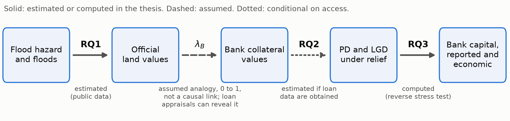
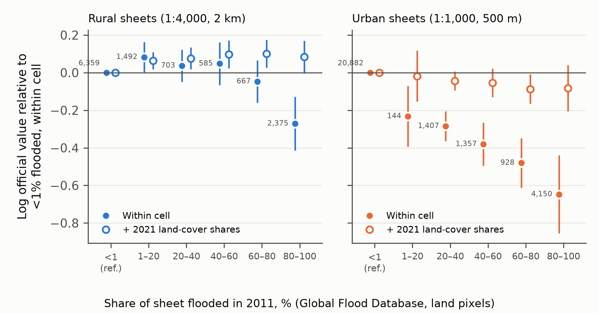

<!-- Working draft. Length: see the body count printed by 06_proposal/render_references.py. -->

# Underwater Collateral: Flood Risk in Official Land Values, Credit under Relief and Bank Capital — Evidence from Thailand

*Research proposal. Working draft.*

---

## Abstract

This thesis traces how flood risk reaches bank capital in Thailand, where few homes were insured in 2011 and debt relief was the main buffer. It asks how official land values adjust after the 2024 floods, whether relief defers flood-induced credit losses, and what flood severity would breach capital requirements. A pilot on 41,049 cadastral map sheets shows that a cross-section cannot separate flood hazard from land use, so the design compares rounds of values on 198 radar-flooded sheets.

---

## 1. Context and importance

Supervisors, including the Bank of Thailand, expect banks to manage climate-related financial risks [@bcbs2022principles; @BOT_StandardPractice_page], tracing hazards through damaged collateral to loss given default (LGD) [@caloia2021flood; @ecb2022climate]. Evidence comes mostly from insured markets: after Hurricane Katrina, insurance proceeds repaid mortgages [@gallagher2017household].

In Thailand, fewer than 1% of dwellings were insured against natural disasters [@worldbank2012thai, p. 59] when the 2011 floods caused damage and losses of about THB 1.43 trillion [@worldbank2012thai, Executive Summary, p. 1]. The buffer was regulatory: lenders could keep debtors' pre-flood classification [@bot2011circular1564], as again after the 2024 and 2025 floods [@bot2024circular601; @bot2025level4]. One Thai bank's mortgage defaults responded modestly to the 2011 flood, which the authors link to relief and rapid recovery [@chitchumnong2025physical]. Whether low post-flood default reflects resilience or deferral matters wherever insurance is thin; Thailand makes it observable, as relief follows documented rules and official values are reset nationwide every four years [@th2019valuationact, s. 19].

## 2. Research aim and questions

**Aim.** To trace how flood risk passes from land valuation to bank capital where relief, not insurance, is the first buffer, stating where a link is assumed rather than measured (Figure 1).

**RQ1. Do official land values capitalise flood risk, and how do they adjust after a flood?** Provincial committees set official values (ราคาประเมินทุนทรัพย์) by market comparison [@th2020appraisalmr] as the base for transfer fees and taxes [@dol2026fees]; bank appraisals are not tied to them [@bot2019collateral]. RQ1 also asks whether carry-over (values unchanged between rounds) slows the response. The Treasury found no post-2011 fall in flooded areas and left its schedule unrevised [@mgr2012appraisal].

**RQ2. Does relief defer or prevent the credit losses that floods cause,** and how does flood exposure move the probability of default (PD) and LGD?

**RQ3. What flood severity would breach banks' capital requirements,** and how much capital does relief hide?

**Figure 1. From flood hazard to bank capital.** λ_B is the share of the hazard discount that bank appraisals recognise. *Source:* author.

## 3. Literature, contribution and hypotheses

Flood risk is capitalised into prices, by about 4.6% for inland 100-year floodplains [@beltran2018flood, abstract]. Closest to RQ1, Melbourne statutory valuations discount designated flood zones [@fuerst2021pricing]; New York assessments fell after Hurricane Sandy for inundated homes but not for undamaged high-risk homes whose prices fell [@guo2026rising]; English lender valuations did not follow prices down [@garbarino2021high]; in Hat Yai, flood risk lowers rents and official valuations in a cross-section [@chongwilaikasaem2022flood]; and Semarang's official zone values gained fewest rupiah near tidal flooding [@utami2021impact].

On credit, euro-area floods raise corporate default by about 0.7 percentage points [@albertazzi2026physical, Section 1] and the 2024 Valencia floods raised stage 2 classification by about half a point [@perezmontes2025impact, pp. 19–21], without measuring collateral values or LGD. European small-business default hazards dip for six months after a flood, then rise, tentatively attributed, without relief data, to aid and payment suspensions [@barbaglia2024flooded, Table 7]. Moratoria change borrowers' behaviour [@dinerstein2024debt; @kim2024intermediation], uninsured damage raises delinquency [@kousky2020flood], and weak banks may hide losses [@caballero2008zombie; @blattner2023losses]. Flood stress tests estimate capital depletion under fixed scenarios [@caloia2021flood; @caloia2026floods], the disaster that would fail a small bank [@blickle2025bad] or the probability of the 2011 scenario for one Thai bank [@chitchumnong2025physical]; none treats relief as a dimension of the breaking point.

**Contribution.** (i) To my knowledge, the first controlled estimate of how an emerging market's official valuations respond to a flood, set by committees on a fixed cycle without an insurance signal. (ii) Evidence on when flood losses are recorded under relief. (iii) A breaking point that separates reported from economic capital under relief, adapting @grundke2018macroeconomic.

**Framework.** Let λ_T and λ_B be the shares of a fully informed hazard discount that official values and bank appraisals recognise. The full discount is the 4.6% above, from richer markets, halved and doubled, as I found no Thai estimate. RQ1 bears on λ_T; RQ3 varies λ_B from 0 to 1 unless loan appraisals reveal it, with the Bank of Thailand's appraisal-based regional index as a coarse check [@bot2026rppislides, pp. 3, 7–9].

**Hypotheses** (mine, not established results).
- **H1a.** At the first round after the 2024 floods, values on flooded land fall relative to comparable unflooded land, less where ex-ante hazard was high.
- **H1b** (descriptive). Carry-over is more frequent on flooded land.
- **H2a.** Flood exposure raises PD and LGD more where origination appraisals, relative to the official value then in force, do not fall with mapped hazard.
- **H2b.** Under the 2024–25 relief, flood-induced delinquency is recorded mainly after relief ends.
- **H2c** (2011, if records survive). Relief defers rather than avoids loss: eligible borrowers' delinquency rises when relief ends, and five-year discounted loss matches comparable ineligible flooded borrowers' within 5 percentage points of exposure (a loose margin).

## 4. Methods

### 4.1 RQ1: official values and flood risk

**Data.** The Treasury Department publishes only the 2023–26 round; my snapshot locates 95.8% of 37.8 million parcels on cadastral map sheets (2 km square rural, 500 m urban). Flood maps are the Global Flood Database for 2011 [@tellman2021satellite], my nationwide Sentinel-1 radar maps for 2024–25 and UNOSAT's 2024 extents for Chiang Rai and Phayao; elevation is from Copernicus [@esa2022copdem], permanent water from @pekel2016high, land cover from @zanaga2022worldcover.

**Outcome.** Parcels are grouped by sheet and 2023–26 value, then followed by parcel number. The primary outcome is the change in log value per square wah between rounds, sheets weighted equally; secondary outcomes are carry-over and, bounded for selection [@lee2009training], the change where values moved.

**Design.** As cross-sections confound hazard with land use (Section 5), identification comes from changes across rounds. A sheet is flooded if radar shows new water, absent from every 2023 image of the season, on over 25% of it in 2024. Controls are under 1% flooded in every 2024–25 map, at least 5 km away and no higher above the valley floor than nine in ten flooded sheets. Changes are regressed on flooding, province effects (absorbing each committee's general revaluation), elevation, distance to permanent water and 2021 land cover; flooding tests H1a, and a flood × height interaction (secondary) its hazard gradient. An OSF pre-analysis plan fixes sensitivities before the 2027–30 round appears.

**Samples.** Four provinces have at least 25 flooded sheets: 198 in Chiang Rai, Phayao, Nong Khai and Nakhon Phanom, in 21 clusters of 1:50,000 sheets, with 1,891 controls. Sentinel-2 shows new water on 57–88% of radar-flooded sheets by province, 1% of controls. In Chiang Rai and Phayao, 79% are flooded in UNOSAT's map, but radar finds only 7% of the 1,214 sheets UNOSAT shows over 25% flooded, missing flash floods and water among buildings. Radar measures prolonged inundation and the co-primary UNOSAT sample (18 treated clusters, 579 controls) any flooding; the two tests are Holm-adjusted. Radar-flooded sheets started cheaper and less built-up (standardised differences −0.41 and −0.68), so both samples' controls are reweighted within province on value, height, built-up and cropland shares and map scale (effective 98 and 104).

**Inference and power.** Inference uses 1,000 placebo footprints shifted within province onto equally low-lying dry sheets, with the wild cluster bootstrap [@cameron2008bootstrap] as a check, and as the UNOSAT test (too few controls). Assuming sheet-level changes with standard deviation 0.10 log points and within-cluster correlation 0.2, the weighted radar sample detects a fall of 0.053 with 80% power and the UNOSAT sample 0.061. That is about the full hazard discount and half the fall in inundated New York assessments [@guo2026rising, Table 3], so a null cannot separate partial from no recognition.

**Interpretation.** Falls graded by flood duration point to damage, uniform cuts to administrative relief, and falls reaching briefly flooded land or persisting into the next round to recognised risk; in Chiang Rai and Phayao, the two maps separate duration from province.

### 4.2 RQ2: credit risk under relief

**Data.** With pseudonymised data on a bank's land-secured loans, flood exposure is computed at the collateral's map sheet inside the bank's secure environment. Outcomes are 90-day delinquency, restructuring and IFRS 9 stages [@bot2018tfrs9], with haircuts, revaluations and provisions as early LGD proxies.

**Designs.**
- **2024–25 (primary).** Relief followed disaster-zone declarations or alert levels [@bot2024circular601] and, in 2025, covered retail and SME debtors in Level-4 areas, such as Songkhla, not non-performing on 2 December 2025 [@bot2025level4, pp. 1–2]. Borrowers on flooded and comparable unflooded sheets are compared month by month from a year before the floods to a year after relief ends, with the two floods as cohorts [@callaway2021difference]. The share of the flood-induced gap that opens only after relief ends is RQ3's deferral share. Relief's own effect comes from its rules: Level-4 areas against lighter relief in neighbouring provinces, and borrowers either side of the cut-off. At base delinquency of 3–5% (assumption), 1,100–2,300 flooded borrowers detect a rise of 2 percentage points, with clustering; a euro-area-sized 0.7 points needs 8,700–19,000.
- **2011 (extension).** Relief covered debtors at most three months overdue [@bot2011circular1564, Q&A 2]. A fuzzy discontinuity in discrete months overdue [@kolesar2018inference], differenced between declared and undeclared flooded areas, netting out the boundary (pre-flood years test this), identifies relief for borrowers in arrears. H2c needs up to 30,000 borrowers on each side in each area: pooled lenders or bureau data.

**Access and Plan B.** Routes are a bank–University agreement, the National Credit Bureau and an external-researcher programme; I judge the chance of loan data well below one half. Otherwise Chapter 3 repeats Chapter 2's design on the 2025 floods: 437 sheets in nine provinces flooded in 2025 but not 2024, with 7,664 controls and a detectable fall of 0.03.

### 4.3 RQ3: reverse stress test

Scenarios use return-period maps up to 1,000 years [@ward2020aqueduct; @dottori2016global], fully dependent or independent across basins, with Asian depth–damage functions that include Thai data [@huizinga2017global, p. 13]. PD responses come from published Thai estimates [@chitchumnong2025physical], observed under relief and so a lower bound, and, with access, RQ2. Recovery is the appraisal less damage, less the unrecognised share 1 − λ_B of the hazard discount, less a sale haircut. Over two years, reported capital follows staging as relief delays it; economic capital recognises deferred losses at once. S* is the most probable scenario that pushes the common equity tier 1 ratio below the minimum plus buffers [@grundke2018macroeconomic]: 7% of risk-weighted assets, 8% for domestic systemically important banks [@bot2012capital, cl. 5.3.1; @bot2017dsib, cl. 4.3.2]. The headline is the gap between S* on reported and economic capital as the deferral share varies. λ_B matters less: in a stylised book, moving it from 0 to 1 shifts S* by 3–19% at loan-to-value ratios of 0.8–1.0. RQ1 gives λ_B one scenario; RQ2, with access, the deferral share. Scenarios rarer than 1 in 1,000 years are implausible, as at Basel's 99.9% confidence level [@bcbs2005irb, p. 11]. Deferral is material if, for any λ_B, economic capital breaks at a return period one step shorter (1,000, 500, 200 years) than reported capital. Credit follows the Bank of Thailand's December 2025 provincial shares by booking office, which overstate Bangkok's. Results cover the system and stylised banks, never a named bank.

## 5. Data and feasibility

**In hand.** Official values, flood maps, terrain, land cover and provincial credit, in a reproducible pipeline; loan-level code tested on synthetic data.

**Pilot (exploratory).** In 17 Chao Phraya basin provinces, comparing same-scale sheets within each 1:50,000 sheet, values on 80–100% flooded sheets are 0.65 log points lower on urban sheets (standard error 0.10) and 0.27 lower on rural sheets (0.07) than on sheets under 1% flooded (Figure 2). Those urban sheets are less built-up (14% against 36%); with land-cover controls, the urban gap shrinks to 0.08 (0.06) and flooded rural bins lie above the reference. Land cover may itself respond to hazard, so neither is a hazard discount.

**Figure 2. Official land values and the 2011 flood, 17 Chao Phraya basin provinces.** Sheet mean log value by share flooded in 2011, relative to under 1%, without (filled) and with (hollow) land-cover controls; bars ±2 clustered standard errors. *Sources:* Treasury Department; Global Flood Database [@tellman2021satellite]; ESA WorldCover [@zanaga2022worldcover]; author's calculations.

**Research governance.** Only public data and data under University agreements are used. Approaches to banks come from the University. Personal data fall under Thailand's Personal Data Protection Act, UK GDPR and University ethics review. pre-analysis plans are public; [named adviser], outside the supervisory team, reviews RQ2's interpretation; no bank-identifiable results are published.

**Preparation.** [Author to state prior quantitative training and which parts of the pilot they built.]

## 6. Expected results and policy relevance

If official values adjust slowly, owners of damaged land are taxed on pre-flood values. If relief defers loss, stress tests calibrated on observed post-flood default overstate resilience. A large gap between reported and economic S* would argue for flood scenarios on economic capital. Nulls are reported with equal weight.

## 7. Draft thesis outline and timeline

1. *Introduction and framework.*
2. *Underwater valuations* (RQ1).
3. *Deferred, not avoided?* (RQ2), or without access, *A second flood* (2025).
4. *Breaking point* (RQ3).
5. *Conclusion and policy implications.*

| Period | Work |
|---|---|
| Before Year 1 | Radar rule checked against Sentinel-2 imagery in all four provinces (done 2 November 2026; no province fell below the pre-set one-half precision); pre-analysis plans for the 2024 and 2025 designs then registered on OSF Registries on [date], with the analysis code, already tested on a simulated round. The 2027–30 round must be published at least 30 days before it takes effect [@th2019valuationact, s. 19], so by 2 December 2026 for a 1 January 2027 start; Treasury offices were briefed in October 2026 on extending current schedules, and a provincial committee considered an extension on 2 November, which could delay the round by up to a year [@th2019valuationact, s. 19; @treasury2026extbriefing; @treasury2026chachoengsao]. A plan registered later makes that analysis exploratory. Survey periods [@th2020appraisalmr] confirmed with the provincial offices concerned (four for 2024, nine for 2025); earlier rounds requested to calibrate power. |
| Timing cases (fixed in the pre-analysis plan) | (a) Round on time, surveyed after the floods: it is the primary test, and the next round (by December 2030) tests persistence. (b) Surveyed before the floods: it is a placebo, the next round is the primary test, and persistence is not testable within the programme, so recognised risk rests on briefly flooded land. (c) One-year extension: the first post-flood schedule is published by early December 2027, and (a) or (b) applies with every later date a year on; under (b) and (c) together the primary test falls in Year 4, and the 2025-flood chapter carries Chapter 2 meanwhile. In every case Chapter 2 adds carry-over and the 2025 floods to the first comparison. |
| Year 1 | Training in spatial econometrics. Remaining pre-analysis plans and hazard inputs. Access approaches and ethics review; go/no-go by year end. Under (a) or (c), Chapter 2's first comparison. |
| Year 2 | Chapter 2: round-to-round design, carry-over and the 2025 floods; working paper. Chapter 4 calibrated on public data and published estimates. With access, the 2024–25 design begins; the 2011 design if records survive. |
| Year 3 | With access: the rest of Chapter 3 and the Chapter 4 update. Without: the 2025-flood chapter; Chapter 4 finalised as illustrative. Working papers and conferences. Under (a), the persistence test; under (b), Chapter 2's primary test on the next round. |
| Year 4 (if needed) | Revisions, integration and submission. |

## References

<!-- generated by 06_proposal/render_references.py; do not edit by hand -->
