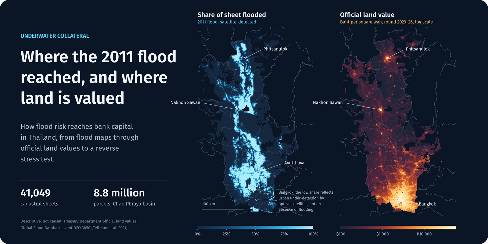
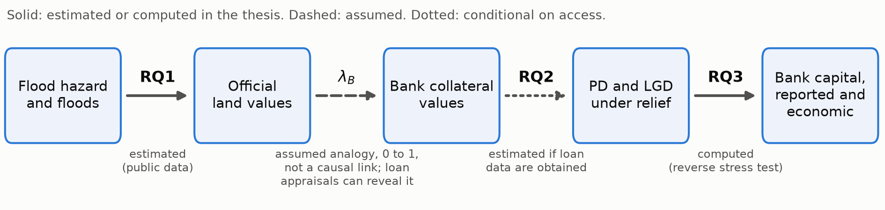

<p align="center">
  <a href="https://thanatchon36.github.io/underwater-collateral/paper/#fig:maps">
    
  </a>
</p>

<p align="center"><sub><b>Figure 2 of the <a href="https://thanatchon36.github.io/underwater-collateral/paper/#fig:maps">working paper</a>, restyled.</b> Each cell is one cadastral sheet (2 km rural, 500 m urban). The 2011 flood share is from MODIS at 250 m, which under-detects flooding in built-up areas. Descriptive only.</sub></p>

<h1 align="center">underwater-collateral</h1>

<p align="center">
  
  
  
  
  
  <a href="https://doi.org/10.5281/zenodo.23949061"></a>
  <a href="https://huggingface.co/datasets/thanatchon36/underwater-collateral-data"></a>
</p>

<p align="center">
  📖 <a href="https://thanatchon36.github.io/underwater-collateral/paper/"><b>Read the paper on the web</b></a> ·
  📕 <a href="paper/paper.pdf"><b>Working paper (PDF)</b></a> ·
  📄 <a href="06_proposal/proposal.md"><b>Read the proposal</b></a><br>
  📋 <a href="06_proposal/one_pager.md"><b>One-page summary</b></a> ·
  📝 <a href="05_design/pre_analysis_plan_rq1_draft.md"><b>RQ1 pre-analysis plan</b></a> ·
  🔬 <a href="04_analysis/pilot_report.md"><b>Pilot report</b></a>
</p>

**Research proposal and public-data pilot on how flood risk reaches bank capital in Thailand.** Few Thai homes were
insured when the 2011 floods struck, so regulatory debt relief, not insurance, was the main buffer for borrowers.
The project follows the chain from flood hazard, through official land values and bank collateral, to default,
recoveries and capital. It states which links are estimated and which are assumed.

- **RQ1, official land values (core, public data):** do the Treasury's official land values capitalise flood
  risk, and how do they adjust after a flood? The design compares valuation rounds on map sheets flooded in 2024
  with unflooded sheets at similar height above the valley floor.
  - 198 radar-flooded sheets in four provinces.
  - 1,214 UNOSAT-flooded sheets in Chiang Rai and Phayao.
  - The design and code are pre-registered before the next round is published.
- **RQ2, credit under relief (conditional on loan-level access):** does relief defer or prevent the credit losses
  that floods cause? The code is tested on synthetic data with known parameters. Without access, the Plan B
  chapter repeats the RQ1 design on the 2025 floods (437 sheets in nine provinces).
- **RQ3, breaking point (core):** a reverse stress test that finds the flood severity at which bank capital falls
  below a regulatory threshold, on reported and on economic capital. The gap between the two measures the capital
  that relief hides.

## Setup and quickstart

```bash
python3.12 -m venv .venv && .venv/bin/pip install -r requirements.txt   # pinned versions
.venv/bin/python -I 04_analysis/src/download_treasury_appraisal.py       # one of the download_*.py scripts
.venv/bin/python -I 04_analysis/run_all.py                               # rebuild everything from raw, then test
.venv/bin/python -I -m pytest -q 04_analysis/src                         # tests only
```

Raw data are not in git: `03_data/raw/` is immutable and rebuilt by the download scripts. Each dataset's URL,
publisher, access date, licence and SHA-256 are in [`03_data/README.md`](03_data/README.md).
`run_all.py` stops at the first failing step.

The processed data that the scripts build (the registered sample files, the Sentinel-1 flood rasters, every derived
table; 117 MB) and the synthetic loan panel are also published on Hugging Face:
[`thanatchon36/underwater-collateral-data`](https://huggingface.co/datasets/thanatchon36/underwater-collateral-data),
with a dataset card that states each folder's source and licence (`04_analysis/src/upload_hf_data.py`). Download
them into `03_data/processed/` and `03_data/synthetic/` to skip the rebuild.

| Command | Purpose |
|---|---|
| `04_analysis/src/download_*.py` | Fetch the raw public data (Treasury values, BOT series, DEM, WorldCover, JRC water) |
| `04_analysis/src/flood_s1_grd.py` | Build Sentinel-1 flood maps for 2023–25 over the network; run once before `run_all.py` (about 25 min) |
| `04_analysis/src/validate_s1_s2.py` | Check the radar rule against Sentinel-2; run once after it (about 15 min) |
| `04_analysis/run_all.py` | Rebuild every processed dataset, table and figure, then run the tests (about 32 min) |
| `04_analysis/src/rq1_round_change.py --post DIR` | Run the registered RQ1 code on the first post-flood round (`--sensitivities`, `--provinces`, `--holm`) |
| `06_proposal/render_references.py` | Resolve citations against `references.bib`, write the rendered proposal and print the body word count |
| `04_analysis/src/rq1_montecarlo_extended.py` | Extended Monte Carlo of the registered RQ1 estimator (1,000 synthetic next rounds per planted effect; wild bootstrap, placebo footprints, H1a interaction, Lee bounds); a separate step, not in `run_all.py`, because it takes about 1.5 hours on 17 cores; `paper_numbers.py` reads its CSV |
| `04_analysis/src/rq1_placebo_diagnostic.py` | Why the placebo-footprint test over-rejects: placebo dispersion and effective controls against the real footprint on three synthetic null rounds (about 10 min); `paper_numbers.py` reads its CSV |
| `04_analysis/src/rq1_placebo_restricted_mc.py` | Repairs to the placebo test on the same synthetic rounds: propensity-restricted pools and a studentised comparison, 200 replications per effect (about 50 min on 18 cores); `paper_numbers.py` reads its CSV |
| `paper/build.sh` | Regenerate `paper/numbers.tex`, tables, figures and `refs.bib` from the script outputs, build `paper/paper.pdf` with tectonic, then the web reader in `docs/paper/` with pandoc (`paper/web.py`; `--no-render` skips the page images) |

## Working paper

[`paper/paper.pdf`](paper/paper.pdf) (47 pages, version of 4 November 2026, revised after a referee-style
review the same day; `07_review/referee_report_paper_round1.md`) is the full write-up of what the project has
so far: the institutional record, the framework, the 2011 cross-section, the pre-specified design for Question 1
with its validation, balance, power against the effects the framework implies, the three samples and the
extended Monte Carlo evidence, the public credit and price aggregates, the Question 2 estimator and power on a
synthetic panel, and the reverse stress test on a synthetic bank with its haircut and damage-share grid. Every
number in the text is a macro in `paper/numbers.tex`, written by `04_analysis/src/paper_numbers.py` from the
CSVs in `04_analysis/outputs/tables/`, so the paper cannot drift from the script outputs.

What the paper does **not** contain: the primary estimate for Question 1. It needs the first official valuation
round published after the 2023–26 round, which has not appeared; provincial committees were considering a
one-year extension as of 3–4 November 2026 (Section 6.5 of the paper). The extended Monte Carlo found that the draft plan's
primary test for the radar samples, randomisation inference over shifted placebo footprints, rejects a true null
19.5% of the time on synthetic next rounds (the wild cluster bootstrap: 5.5%), because shifted footprints land on
better-overlapped sheets than the real one; `04_analysis/src/rq1_placebo_diagnostic.py` shows why; `rq1_placebo_restricted_mc.py` shows that
restricting where footprints may land does not repair the test (size 0.200) and that studentising the comparison
does (0.055); the plan proposes to make the bootstrap primary and the placebo check studentised before registration
(Section 6.5 of the paper, PAP §6). The pre-analysis
plan is not yet registered. The repository is public and each release is archived on Zenodo
(concept DOI [10.5281/zenodo.23949061](https://doi.org/10.5281/zenodo.23949061), which resolves to the latest
release), and the sample files, which are rebuilt rather than
stored in git, are on [Hugging Face](https://huggingface.co/datasets/thanatchon36/underwater-collateral-data), where the
sample-file hashes in the paper can be checked directly; they will also be archived with the registration.

## Research proposal: *Underwater Collateral*

The full title is *Underwater Collateral: Flood Risk in Official Land Values, Credit under Relief and Bank
Capital — Evidence from Thailand*. The proposal is in [`06_proposal/proposal.md`](06_proposal/proposal.md), with a rendered copy with references in
[`proposal_rendered.md`](06_proposal/proposal_rendered.md). It is a working draft that the author will rewrite
in their own words.

Every number in the proposal is traced to a source or a script output in
[`claims_ledger.csv`](06_proposal/claims_ledger.csv). Every reference in
[`references.bib`](01_literature/references.bib) records where and when it was verified.

<p align="center"></p>

What the pilot found (details in the [pilot report](04_analysis/pilot_report.md)):

- **The cross-section cannot separate hazard from land use.**
  - 36.2 million of 37.8 million parcels (95.8%) are located on cadastral map sheets.
  - Urban land flooded in 2011 is valued about 48% lower than nearby unflooded land (rural land 24%).
  - Controlling for 2021 land cover removes almost all of that gap.
  - The primary design therefore compares rounds of values, not places.
- **The treated units for 2024 exist.**
  - 198 sheets are more than 25% flooded on radar maps built by a fixed rule.
  - That is enough, under stated assumptions, to detect a fall of about 0.05 log points, close to the assumed full
    hazard discount.
  - Sentinel-2 confirms new water on 68% of them (pooled).

Supporting documents:

- Design: research questions, framework, identification, data-access plan and ethics in [`05_design/`](05_design/).
- Pre-registration:
  - [OSF form](05_design/osf_registration_form.md);
  - [registration checklist](05_design/registration_checklist.md);
  - [deviations log](05_design/deviations_log.md).
- Literature: review, gap statement and matrix in [`01_literature/`](01_literature/).
- Review history: the referee report on the working paper, citation audits and the revision log in [`07_review/`](07_review/).
- Author notes for each proposal section: [`06_proposal/notes/`](06_proposal/notes/).

Reproduce:

```bash
.venv/bin/python -I 04_analysis/run_all.py    # processed data -> RQ1 samples -> registered code on a synthetic round -> figures -> tests
git checkout -- 04_analysis/outputs/figures/  # restore figure PDFs whose only change is the creation date
```

## Data governance

- **Public data only.** Every dataset is publicly available.
- **Restricted data are prepared for, not touched.** For loan-level data, the repository holds only the schemas
  ([`03_data/schemas/`](03_data/schemas/)) and seeded synthetic data.
- **Downloads.** Every download is public and needs no login, and is logged with its licence.

## Repository layout

| Path | Contents |
|---|---|
| `01_literature/` | Literature review, gap statement, matrix, `references.bib` |
| `02_policy_context/` | Thai relief and valuation rules, from public documents |
| `03_data/` | Data log, schemas, synthetic data (raw and processed data not in git) |
| `04_analysis/` | Scripts (`src/`), tests, outputs, pilot report, method notes |
| `05_design/` | Design documents, RQ1 pre-analysis plan, OSF form |
| `06_proposal/` | Proposal, one-pager, claims ledger, author notes |
| `07_review/` | Referee reports, citation audits, revision log |
| `paper/` | Working paper: LaTeX sources, generated numbers and tables, PDF, web reader builder |
| `docs/` | Web version of the paper (GitHub Pages) |
| `PROGRESS.md` | Current phase, open questions, next steps |

## Citation

This is a working draft. To cite the repository, use the Zenodo concept DOI, which always resolves to the latest
release:

> Chongmankhong, T. (2026). *underwater-collateral: flood risk in official land values, credit under relief and bank
> capital (Thailand)*. Zenodo. https://doi.org/10.5281/zenodo.23949061

GitHub's "Cite this repository" button reads `CITATION.cff`. Once the RQ1 plan is registered, cite the OSF
registration alongside. License: all rights reserved. Views and errors are the author's own.
